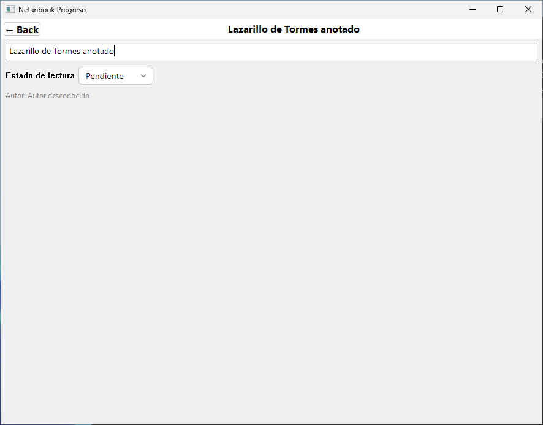
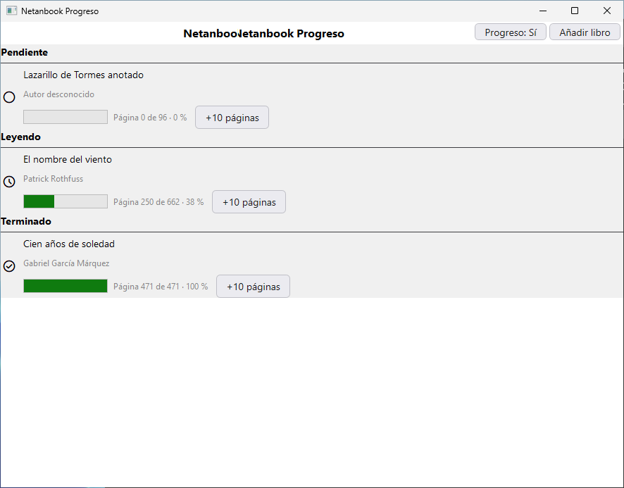
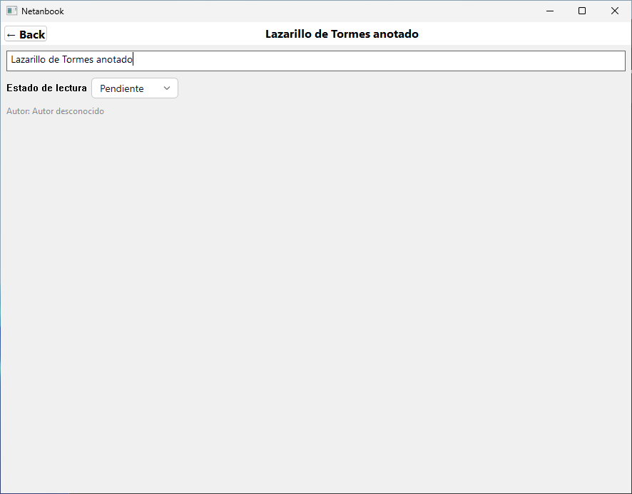
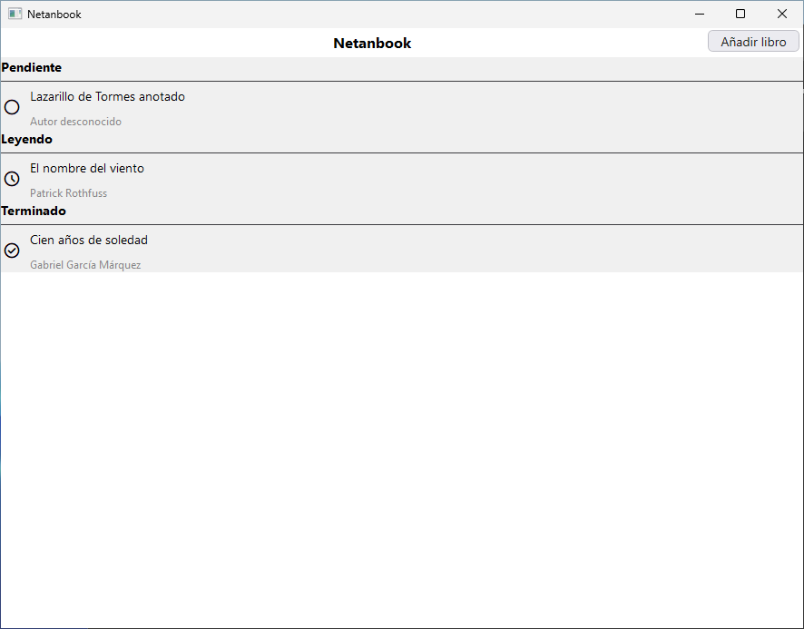

# Sesión 5 · Navegación, paso de datos y Git Flow

**Universidad de Almería · Grado en Ingeniería Informática · Líneas de Productos de Software**
**Producto:** Netanbook (nuestra BookApp)
**Equipo:** Marcos Sánchez García · Javier Zúñiga Carmona · Maria Camila Soto Zapata · Daniel Arevalo Almendros

---

## 1. Qué entregamos

| Criterio | Evidencia |
|---|---|
| Navegación | `BookListView` está dentro de un `NavigationStack` y cada fila es un `NavigationLink` a `BookDetailView`. Funciona en los dos productos (`Netanbook` y `Netanbook Progreso`). |
| Paso de datos | El detalle recibe el libro con `@Binding`. Lo que se edita cambia el libro del ViewModel y el listado lo muestra al volver (apartado 5). |
| Un solo código | La navegación y el detalle están escritos una vez, sin `#if`. Compilan en Xcode (macOS) y con `swift build` (Linux y Windows). |
| Git Flow | Ramas `main`, `develop` y `feature/detalle-libro-marcos`, integrada en `develop` con un commit de fusión (apartado 6). |
| Capturas | Apartado 5: detalle y listado tras modificar un libro, en Windows. Apartado 6: `git log --oneline --graph`. |
| `.gitignore` | Excluye `.build/`, `DerivedData/` y `xcuserdata/`. `Package.resolved` sí está en el repositorio. |

---

## 2. Vista de detalle: `BookDetailView`

Fichero nuevo en `Netanbook/Core/Views/`. Es un `Form` con el título (campo de texto) y el estado de lectura (selector con los tres estados). Usa el título del libro como título de la pantalla.

```swift
struct BookDetailView: View {
    @Binding var book: Book

    var body: some View {
        Form {
            TextField("Título del libro", text: $book.title)
            Picker("Estado de lectura", selection: $book.status) {
                ForEach(ReadingStatus.allCases, id: \.self) { status in
                    Text(status.displayName).tag(status)
                }
            }
            Text("Autor: \(book.author ?? "Autor desconocido")")
        }
        .navigationTitle(book.title)
    }
}
```

El detalle no conoce el ViewModel. Solo recibe un enlace al libro: `$book.title` y `$book.status` leen y escriben a través de él.

---

## 3. Listado con navegación

Cambios en `BookListView`:

- La lista está dentro de `NavigationStack`.
- `bookRow(book:)` crea cada fila como un `NavigationLink` cuyo destino es el detalle, con un binding a ese libro.
- Los botones («Añadir libro» y, solo con `#if Progreso`, «Progreso: Sí/No») están en `.toolbar`.
- Cada fila tiene un menú contextual con «Eliminar libro». En escritorio sustituye al gesto de deslizar de iOS.

```swift
private func bookRow(book: Book) -> some View {
    NavigationLink(destination: BookDetailView(book: binding(for: book))) {
        rowContent(for: book)
            .contextMenu {
                Button("Eliminar libro") { removeBook(id: book.id) }
            }
    }
}

private func binding(for book: Book) -> Binding<Book> {
    Binding(
        get: { viewModel.book(id: book.id) ?? book },
        set: { viewModel.updateBook($0) }
    )
}
```

`binding(for:)` construye el `Binding` a mano. No guarda el libro: guarda una función para leerlo (`get`, que se lo pide al ViewModel) y otra para escribirlo (`set`, que llama a `updateBook`). Usamos esta forma, y no `List($viewModel.books)`, por dos motivos: `books` sigue siendo `private(set)` (solo el ViewModel lo modifica) y el compilador de Swift 6.3 para Windows falla con la otra forma, como indica el guion.

La fila (`BookRowView`) no cambia: sigue recibiendo el libro, los flags y las acciones como closures. Pulsar el botón de estado de la fila cambia el estado sin abrir el detalle. Pulsar el resto de la fila abre el detalle.

---

## 4. Operaciones nuevas del ViewModel

`BookListViewModel` gana tres métodos:

| Método | Qué hace |
|---|---|
| `removeBook(id:)` | Borra el libro del listado. |
| `book(id:)` | Devuelve el libro con ese `id`, si sigue en el listado. Lo usa el `get` del binding. |
| `updateBook(_:)` | Sustituye el libro que tiene el mismo `id`. Lo usa el `set` del binding. Si el título queda vacío, conserva el título anterior: la regla «el título no puede estar vacío» sigue en el modelo (`Book.isValidTitle`). |

Con F1 compilada, al borrar un libro la lista borra también su progreso (`ReadingProgressViewModel.removeProgress(bookID:)`). Esa llamada está en `BookListView`, dentro de `#if Progreso`: el ViewModel del Core sigue sin saber que el progreso existe.

---

## 5. Comprobación en los dos productos

La CI lo comprueba en cada push:

- **macOS:** compila los schemes `Netanbook` y `Netanbook Progreso` del proyecto de Xcode.
- **Linux:** compila y arranca los dos productos de `Package.swift`.
- **Windows:** además ejecuta `scripts/probar-interfaz.ps1` en los dos productos. El script entra en el detalle de «Lazarillo de Tormes», añade « anotado» al título, vuelve al listado y comprueba que la fila muestra el título nuevo. Las capturas son de esa ejecución.

Resultado de la CI en la rama `feature/detalle-libro-marcos`: los tres sistemas en verde. En Windows, en los dos productos, el listado muestra «Lazarillo de Tormes anotado» al volver del detalle y la fila de «Cien años de soledad» desaparece tras «Eliminar libro». En Netanbook Progreso, con el flag activado se ven los tres textos de progreso.

### Capturas (Windows, Netanbook Progreso)

| Detalle del libro, con el título editado | Listado al volver |
|---|---|
|  |  |

### Capturas (Windows, producto base)

| Detalle del libro, con el título editado | Listado al volver |
|---|---|
|  |  |

El resto de capturas de la prueba (listado inicial, progreso visible, detalle sin editar y listado tras borrar) están en [`capturas/`](capturas/).

---

## 6. Git Flow

| Rama | Uso |
|---|---|
| `main` | Código estable: lo que se entrega. |
| `develop` | Integración de las características. |
| `feature/<característica>-<nombre>` | Una rama por característica y miembro. Sale de `develop` y vuelve a `develop` con un commit de fusión (`--no-ff`). |

Ramas de Marcos: `feature/detalle-libro-marcos` (sesión 5) y `feature/persistencia-ajustes-marcos` (sesión 6).

En esta sesión:

1. `develop` sale de `main`.
2. `feature/detalle-libro-marcos` sale de `develop` y lleva los commits de la navegación y el detalle.
3. La rama se integra en `develop` con un *pull request* ([#1](https://github.com/ualmarcossanchez/netanbook/pull/1)) fusionado con commit de fusión («Create a merge commit», que equivale a `git merge --no-ff`).

Para ver el historial con las ramas:

```shell
git log --oneline --graph --all
```

Captura pendiente: hay que hacerla con ese comando cuando los *pull requests* estén fusionados y guardarla como `capturas/git-log.png`.

Las ramas de característica de Javier, Maria Camila y Daniel las crea cada uno desde `develop` con el mismo patrón (`feature/<característica>-<nombre>`) y las integra igual.

---

## 7. Preguntas de diseño

### ¿Quién es dueño del dato editado? ¿Qué pasaría con una copia?

El dueño es el **ViewModel** (`BookListViewModel.books`). El listado solo lo lee y el detalle recibe un enlace (`@Binding`), no el dato.

Si el detalle recibiera `let book: Book`, tendría una copia (`Book` es un `struct`): no podría modificarla y, aunque la guardara en un `@State` propio para editarla, el cambio se quedaría en el detalle. Al volver, el listado seguiría mostrando el libro antiguo. La prueba de Windows comprueba justo lo contrario: tras editar en el detalle, la fila muestra el título nuevo.

### ¿Dónde deben ir los datos de una característica opcional, como el progreso, para que el detalle funcione con ella desactivada?

En la propia característica, no en `Book`. El progreso vive en `ReadingProgress`, dentro de `ReadingProgressViewModel`, asociado al libro por `bookID`, en `Features/Progreso/` y dentro de `#if Progreso`.

Así el detalle edita un `Book` que es igual en los dos productos: no tiene campos de progreso que estén vacíos o sobren cuando F1 no se compila o su flag está apagado. Si más adelante el detalle muestra el progreso, lo recibirá aparte (dentro de `#if Progreso`), igual que la fila.

### ¿Qué ficheros darán conflicto al integrar? ¿Por qué un `.swift` nuevo no lo da en `project.pbxproj`?

Los que tocan varias personas a la vez: `project.pbxproj` (targets y ajustes de compilación), `Package.swift` (traits y dependencias) y los ficheros comunes del Core, como `BookListView.swift` o `AppConfig.swift`.

Un `.swift` nuevo no modifica `project.pbxproj` porque el proyecto usa una **carpeta sincronizada** (`Netanbook/`): Xcode compila lo que hay en la carpeta, sin apuntar cada fichero en el proyecto. `Package.swift` hace lo mismo con su `path`. Por eso cada característica nueva va en su carpeta (`Features/<Nombre>/`) y solo toca los ficheros comunes en sus puntos de conexión.

---

## 8. Cómo reproducirlo

- **macOS:** abrir `Netanbook.xcodeproj`, elegir el scheme `Netanbook` o `Netanbook Progreso` y pulsar ▶.
- **Windows y Linux:** `swift run Netanbook` o `swift run --traits Progreso Netanbook`.
- **Prueba de interfaz (Windows):** `powershell -ExecutionPolicy Bypass -File scripts/probar-interfaz.ps1 -Variante Progreso`

Comprobaciones a mano: pulsar el icono de estado de una fila no abre el detalle; pulsar la fila sí; los cambios del detalle aparecen al volver; el clic derecho sobre una fila ofrece «Eliminar libro».
